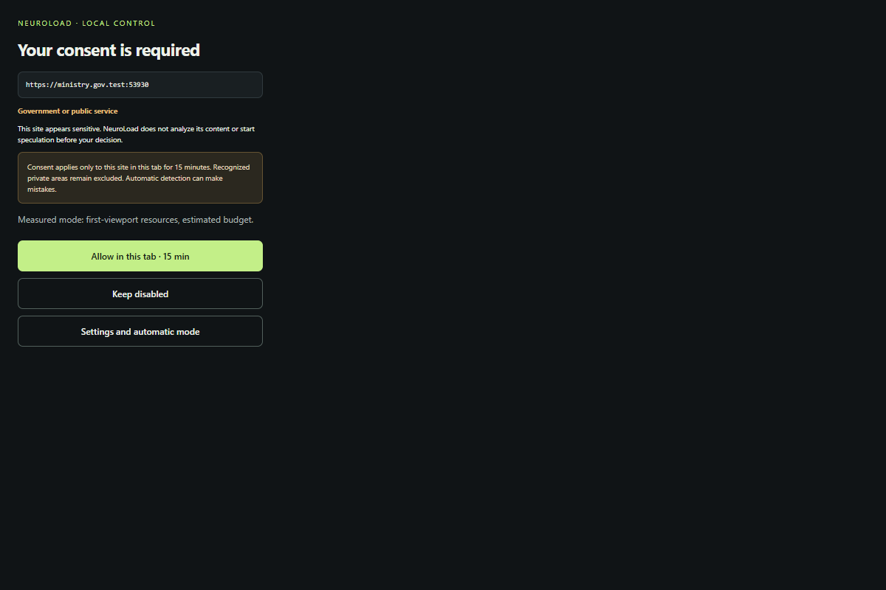

# Automatic HTTPS activation and sensitive-site consent

Introduced in 0.4, with English interface copy in 0.4.1. Only first-viewport resources and the existing budgets are in scope.

## User flow

1. Select **Enable automatic mode** in settings and accept Chrome's optional HTTPS host grant. Installation alone grants no access. Reload existing tabs.
2. Ordinary HTTPS sites can learn their initial resources without typing each address.
3. A recognized sensitive hostname pauses DOM analysis, learning and speculative hints before a decision. The extension popup displays the exact origin and detected category.
4. **Allow in this tab · 15 min** permits eligible public pages for this exact origin in this tab. **Keep disabled** refuses for one hour. You can change/revoke the decision from the tab's extension icon.
5. Expiry, tab closure or access revocation makes approval unusable. Settings changes and data clearing reset temporary records. Expired consent requires a new decision.

The popup is attempted once for a fresh request on the active tab. If Chrome cannot open it, a **?** badge is the fallback. No extra `notifications`, `activeTab` or `tabs` permission is requested. Granted host access supplies the current site URL.

Automatic mode is off by default. **Strict** also remains the default and initiates no speculative content downloads. Choose **Measured** separately to test acceleration; granting sensitive consent does not silently change that mode.

## Classification and hard guards

Local signals include `.gov`, `.gouv`, `.fgov`, selected known public-service roots (Belgium, France, EU and others), finance/health/mail/authentication words and internationalized hostnames. No remote classification service or commercial list is used.

**Classification is incomplete and is not identity verification.** Names can trigger false positives; unknown government/private services can be missed. Unrecognized sensitive sites may activate automatically after the global grant. Keep manual mode when you need browser-enforced domain restriction.

Automatic mode requires `https://*/*`, a technically broad permission. The filters are application controls, not a narrower Chrome permission. Stopping automatic mode attempts to remove this pattern and reports if Chrome retains it.

Private/action hosts, login/payment/API routes, parameters/fragments, exclusions and forms remain blocked despite consent. A detected form suspends that document without an override button. Future page changes, authentication state and redirects cannot be certified. These guards control NeuroLoad speculation, not the browser's ordinary navigation or a site's own traffic.

## Security and storage

- Only the exact extension popup may decide. The worker rechecks schema, real tab URL, exact origin, Chrome grant, scope, exclusions and hard guards. Website scripts and the settings page cannot accept a sensitive request.
- Random request IDs rotate after every decision. Replay and cross-tab decisions fail; another-origin navigation invalidates a pending decision.
- Sensitive profiles exist only in trusted `chrome.storage.session`: at most 32 temporary records, 8 pages and 16 transitions per approved tab. Expiry is checked before reuse. Physical cleanup is on subsequent writes, not a permanent timer.
- Public models stay in the public local store. The network ledger uses SHA-256 destination fingerprints for all sites, not raw URLs. Unsalted hashes are guessable and not encryption. Reservations stay counted for 24 hours after revocation.
- No page content, form value, cookie or password is saved. Native caches and sent requests are not erased by revocation. Native requests can send site cookies.

## Verification and impact

The engine suite passed **95 unit tests and 58 browser checks (153 total)**. The ten automatic-mode browser scenarios cover global activation without a list, ordinary HTTPS learning, government pause, trusted consent UI, denial, temporary learning, first-resource preparation after approval, cross-tab nonce rejection, private routes, expiry and tab closure. Unit checks also cover absent global grants, popup roles, action-host hard blocks and budget fingerprints.

Historical 0.4 evidence: [base](browser-results-0.4.json), [extended](extended-browser-results-0.4.json), [security](security-browser-results-0.4.json), [automatic](automatic-browser-results-0.4.json), [summary](verification-0.4.json). English-build results are recorded in [PUBLICATION-0.4.1.md](PUBLICATION-0.4.1.md).

Tests run on synthetic `.test` domains mapped to localhost, with a deliberately public test TLS key. No real government/bank service is visited and no certificate store is changed. The isolated harness ignores TLS errors only for this synthetic context and pregrants its copied test manifest because the native Chrome grant dialog requires a human. The production manifest retains only optional host access. Stable Chrome and every declared older version are not automatically verified.

The 0.4 [six-navigation benchmark smoke](benchmark-smoke-0.4.md) and [raw data](benchmark-smoke-0.4.json) are functional checks, not a statistically meaningful new speed claim. The [140-navigation 0.2 comparison](OPTIMIZATION.md) remains historical.

Changes introduced by 0.4: optional `automatic` flag, separate popup role, three status/decision messages, trusted session consent and hashed ledger destinations. Prediction/admission budgets remain unchanged. Approved BOOT adds only a sensitive-host flag and expiry. The manifest adds a popup without mandatory permissions. Source, built files, UI, tests and docs change together; no proxy, navigation interception or backend is introduced.

To return to manual access, stop automatic mode, check Chrome removed the broad grant, choose Strict and reload tabs. Remove the extension to stop it entirely. Sensitive session models are not part of the permanent public model.

## Official sources checked before implementation

- [Chrome permissions API](https://developer.chrome.com/docs/extensions/reference/api/permissions): optional grants require a user gesture; actual grants can be checked and removed.
- [Chrome action.openPopup](https://developer.chrome.com/docs/extensions/reference/api/action#method-openPopup): general availability from Chrome 127, policy-installed only on 118–126; badge fallback for the declared minimum 122.
- [Chrome storage/session access](https://developer.chrome.com/docs/extensions/reference/api/storage), [host match patterns](https://developer.chrome.com/docs/extensions/develop/concepts/match-patterns).
- [Native loading API limits](API-LIMITS.md).
